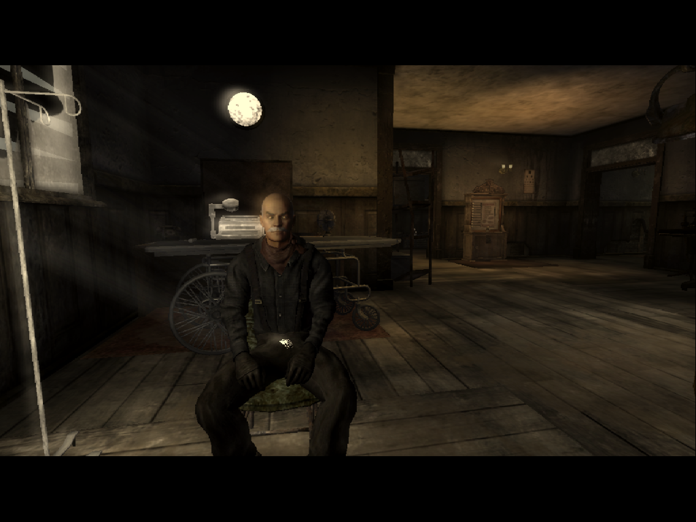

# Fallout: New Vegas — native Linux port

Fallout: New Vegas, statically recompiled from your own copy into native x86-64 Linux code. No Wine, no Proton, no
emulator. It's built on the recompiler and Windows runtime of the
[Dungeon Siege II Linux port](https://github.com/Joshspeakman/dungeon-siege-2-linux) (whose README is now
[docs/DS2-LINUX-README.md](docs/DS2-LINUX-README.md)). Nothing from the game is in this repository: the build
regenerates everything locally from your files, and the game folder is only read.

**State: early development (2026-10-06).** On Linux (CachyOS, RTX 3080 Ti), the recompiled GOG 1.4.0.525 executable:
- starts and shows the intro movie (Bink, recompiled from the game's DLL)
- draws the main menu and plays its music (DirectShow over minimp3)
- starts a new game: keyboard and mouse go through DirectInput 8
- loads Goodsprings and renders Doc Mitchell's house with the game's own shaders (MojoShader → GLSL on OpenGL)



Known gaps: some UI frames don't draw, the sun/moon glare shows indoors (occlusion queries), and render targets are
8-bit (no HDR). Cube/volume textures are stand-ins and there's no fog for shader model 2 shaders. Sound effects are
unverified, and only the opening was exercised. The open work is listed in [docs/FNV-PORT.md](docs/FNV-PORT.md).

## Build and run

Needs the GOG offline installer for Fallout: New Vegas 1.4.0.525 (installer 12010), extracted with `innoextract`, and:

```sh
sudo pacman -S --needed base-devel clang python python-pip pkgconf sdl2-compat freetype2 fontconfig libsndfile glew libpng zlib
recomp/build_fnv.sh "/path/to/extracted/app/FalloutNV.exe"          # about 10 minutes: analysis, lift, compile, link
recomp/work/fnv/app/FalloutNVLinux --exe recomp/work/fnv/FalloutNV.exe --game "/path/to/extracted/app" --data ~/.local/share/fallout-nv-linux
```

`DS_TEST=1` runs windowed with the mouse free; `W32_AUDIO_MUTE=1` silences it. `recomp/tools/fnv_iterate.sh [relink]`
rebuilds and runs a short test session. `FNV_RELINK=1 recomp/build_fnv.sh …` relinks after runtime-only changes.
Saves and settings live under `<data>/drive_c/Users/player/Documents/My Games/FalloutNV`.

## How it works

- `recomp/tools/analyze.py`, `lift.py`: x86 → C, one C function per original function (92,603 for FalloutNV.exe).
  `tools/sse.py` and `runtime/rt_sse.h` add SSE/SSE2/MMX, checked against Unicorn by `tests/fuzz_sse.py`.
- `recomp/runtime/win32`: the Windows API the game uses, including what FNV added: INI files, DirectInput 8
  (`dinput8.c`), DirectShow music (`dshow.c`), D3DX maths (`d3dx9_math.c`), and the game's own D3D9 shaders
  (`d3d9_shader.c`).
- `src/renderer/linux/renderer.c`: OpenGL consumer of the D3D command stream; it compiles the translated shaders.
- `recomp/third_party`: MojoShader (zlib) and minimp3 (CC0).

Fallout: New Vegas is a trademark of its owners; this project is not affiliated with them. You need your own copy.
