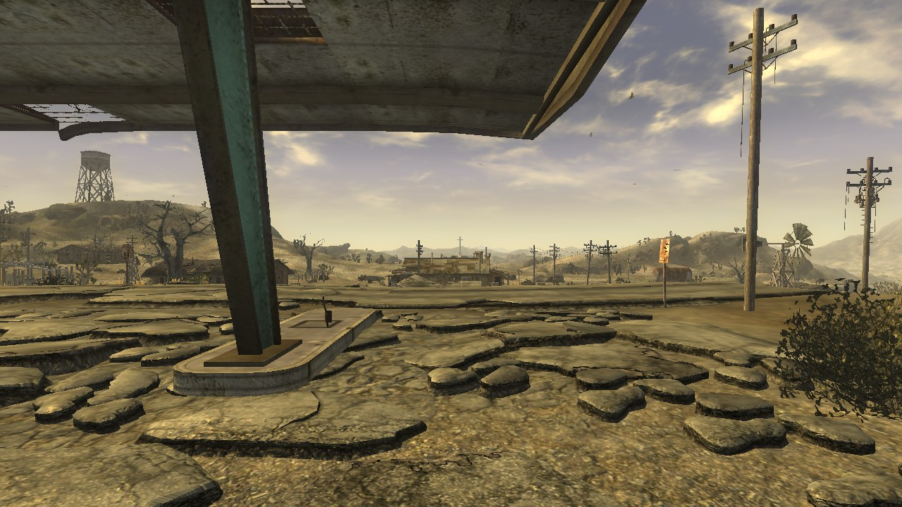
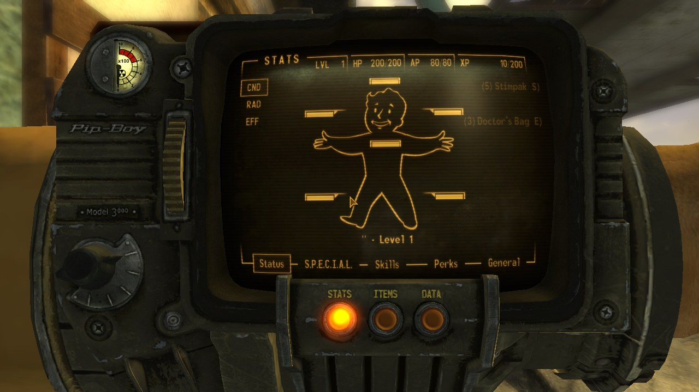
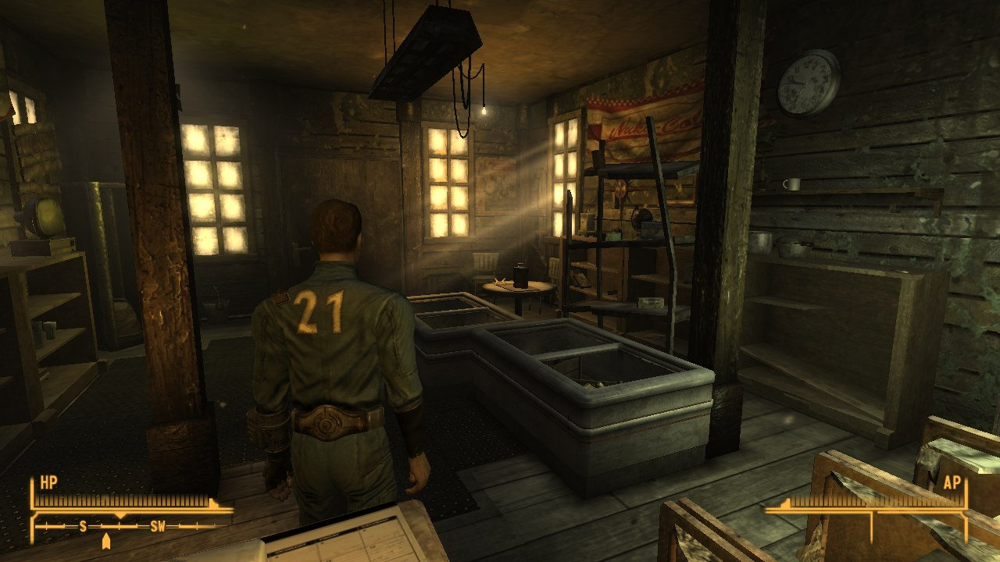
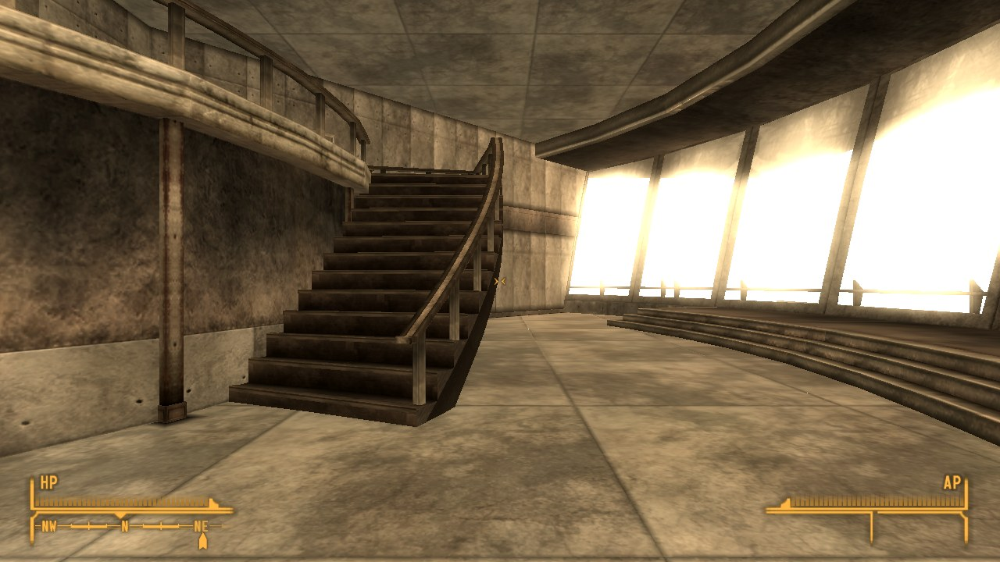
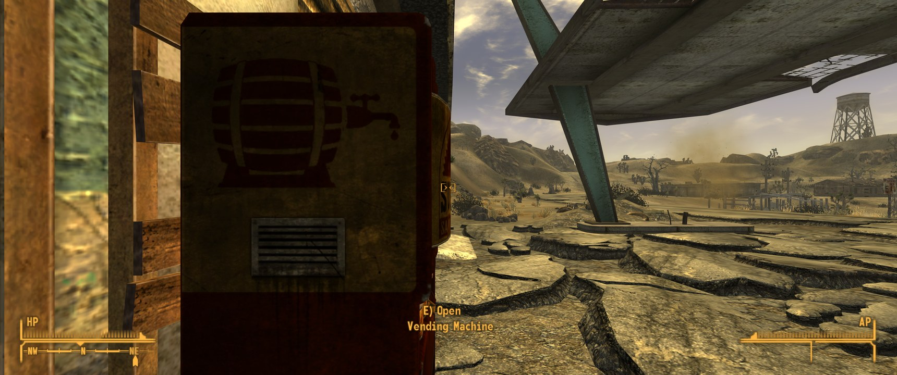
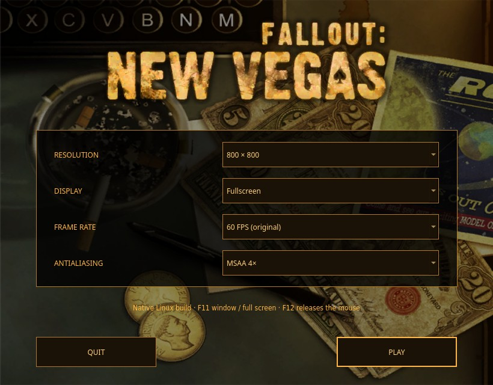

# Fallout: New Vegas — native Mac (Metal) and Linux port

Fallout: New Vegas, statically recompiled from your own copy into native code: arm64 with Metal on Apple Silicon Macs,
x86-64 with OpenGL on Linux. No Wine, no Proton, no Rosetta, no emulator. It's built on the recompiler and Windows runtime of the
[Dungeon Siege II Linux port](https://github.com/Joshspeakman/dungeon-siege-2-linux) (whose README is now
[docs/DS2-LINUX-README.md](DS2-LINUX-README.md)). Nothing from the game is in this repository: the build
regenerates everything locally from your files, and the game folder is only read.

**State: playable, in testing (2026-10-07).** The recompiled GOG 1.4.0.525 executable runs the game from the intro
movie through character creation into the open world. It's checked frame by frame against the original game running
under Proton: both are given the same inputs and screenshots are taken at the same moments. Most scenes come out at
28–41 dB PSNR, which is the same picture to the eye.

| | |
|---|---|
|  |  |
|  |  |



## On the Mac

**State: runs, in testing (2026-10-07), on the `metal` branch.** Tested on a 14-inch MacBook Pro (M1 Pro, 32 GB):

- **Rendering.** The game's own shaders are translated to Metal (MojoShader's Metal profile, patched for Direct3D's
  semantics: half-pixel offset, alpha test, zero-safe maths); all 1,745 unique shader programs in the game compile.
  Goodsprings by day and night, the Prospector Saloon, Doc Mitchell's house, Vault 22, the Lucky 38 penthouse,
  Gomorrah, the Pip-Boy and VATS all render as on Linux; a 12-frame burst shows no flicker.
- **Performance.** A locked 60 fps (the original's rate) everywhere tried, at the display's own 1728×1085 too (GPU
  about 4 ms a frame). Uncapped, Goodsprings at night runs at about 70 fps at 1728×1085 (the CPU is the limit), Doc
  Mitchell's house at about 100 fps at 1280×720, so 60 fps is the recommended setting.
- **Full screen** works from the app (Game Mode turns on), through the intro logos to the main menu.
- **Threads.** The Mac's CPU orders memory more loosely than x86, and the game's own locks rely on x86's order, so
  the build gives guest memory accesses x86's ordering (`RT_TSO` in `recomp/runtime/rt.h`; the thread's own stack is
  left plain, so it costs little), and every `lock`-prefixed instruction is a real hardware atomic.
- **The launch window** shows the game's title and loading-screen art (read from your own archives at install time)
  and sets the resolution, the notch, the frame rate and updates.

Install (Apple Silicon, the Xcode command line tools and python3):

```sh
./install.sh --game-dir "/path/to/Fallout New Vegas"          # the folder with FalloutNV.exe and Data
./install.sh --gog-installer setup_fallout_new_vegas_*.exe      # or the GOG offline installer (brew install innoextract)
./install.sh --nightly                                          # "Fallout New Vegas Nightly.app": the nightly branch
```

It builds for about ten minutes and installs **Fallout New Vegas Native.app** in `~/Applications`. Saves and
settings go to `~/Games/FalloutNVNative`; the game folder is only read.

Sound: the game's streams (music, ambience, voices) are mixed and played through Core Audio, checked by recording
them (`W32_DSDUMP`); they have not been listened to yet, as every test ran muted. Not yet checked on the Mac: play
sessions longer than about four minutes, the DLC, and the Strip (its scripted test took its picture before the
teleport finished). NaNs made by SSE
maths come out positive instead of negative (as arm64 makes them); nothing is known to depend on that.

## What works on Linux

Tested on CachyOS with an RTX 3080 Ti:

- **Rendering.** All 1,809 unique shaders in the game translate to GLSL and compile (MojoShader, patched for
  Direct3D's semantics). Lighting, HDR, eye adaptation, shadows, skinned characters, grass, sky and day/night all
  match the original.
- **Sound.** Music, ambience, effects and voices all play. The intro movie's audio matches a reference decode exactly,
  and Doc Mitchell's lines correlate at 0.999.
- **Movies and menus.** The intro movie, main menu, dialogue and subtitles, character creation (including the
  Reflectron), the Pip-Boy, containers, the pause menu, and saving and loading all work.
- **Combat.** Firing weapons and VATS targeting with queued attacks both work.
- **Places.** Goodsprings, the Prospector Saloon, the general store, Lucky 38, Gomorrah, the Tops, Hoover Dam,
  Vaults 11 and 22, Freeside, Novac, Primm, Hidden Valley and Camp Forlorn Hope all load. A 10-minute tour through
  them ran without a crash.
- **Performance.** Vertex and index buffers stay on the GPU, so Goodsprings runs at 100+ fps uncapped.
- **Quitting** returns to the desktop cleanly.

## Launcher



The original game sets its graphics options in a separate launcher, and so does this port. The launcher reads the
game's title and backdrop artwork from your own archives and offers:

- **Resolution:** any size, with presets for ultrawide (2560×1080, 3440×1440, 3840×1600, 5120×1440, 5120×2160), or
  Custom.
- **Display:** full screen (borderless) or windowed.
- **Frame rate:** 60 fps (the original's rate), any cap up to 1000 fps, your display's refresh rate with VSync, or
  unlimited. Above 60 fps the game's physics normally break; the launcher fixes this by setting the Havok physics
  step to match (`[HAVOK] fMaxTime` = 1 / rate in Fallout.ini).
- **Antialiasing:** FXAA, MSAA 2×, 4× or 8×, or MSAA with FXAA on top.

In game, F11 toggles full screen and F12 releases the mouse.

## Known issues

- After several `coc` console teleports in a row, the third-person camera can face a different way than in the
  original. The player's position and heading are correct.
- Not yet verified: the VATS kill cam, the ending slides, and the DLC worldspaces.

The full status and the history of the fixes are in [docs/FNV-PORT.md](FNV-PORT.md).

## Build and run (Linux)

Needs the GOG offline installer for Fallout: New Vegas 1.4.0.525 (installer 12010), extracted with `innoextract`, and:

```sh
sudo pacman -S --needed base-devel clang python python-pip pkgconf sdl2-compat freetype2 fontconfig libsndfile glew libpng zlib pyside6 python-pillow
recomp/build_fnv.sh "/path/to/extracted/app/FalloutNV.exe"          # about 10 minutes: analysis, lift, compile, link
python3 recomp/host/linux_launcher/fnv_launcher.py --binary recomp/work/fnv/app/FalloutNVLinux \
    --exe recomp/work/fnv/FalloutNV.exe --game "/path/to/extracted/app" --data ~/.local/share/fallout-nv-linux/data
```

`FNV_NO_LAUNCHER=1` skips the launch window and uses your saved choices. You can also run `FalloutNVLinux` directly
with the same `--exe/--game/--data` arguments and these environment variables:

- `DS_RESOLUTION=3440x1440` sets the render size.
- `DS_WINDOW_MODE=windowed|fullscreen` picks the display mode.
- `DSR_FPSCAP` sets the frame cap (`0` is unlimited), and `DSR_VSYNC` turns VSync on or off.
- `DSR_MSAA=2|4|8` and `DSR_FXAA=1` set antialiasing.

Saves and settings live under `<data>/drive_c/Users/player/Documents/My Games/FalloutNV`. `FNV_RELINK=1
recomp/build_fnv.sh …` relinks after runtime-only changes.

## Testing against the original

- **`recomp/tests/scenario.py <name>`** plays one scripted session in both the port and the original
  `FalloutNV.exe`, which runs under Proton in headless gamescope (`tests/fnv_ref.py`). It then compares the
  screenshots.
- **The scenarios** cover the opening, Goodsprings at noon, dusk and night, the interiors, the Pip-Boy, combat, and
  frame bursts that catch flicker. They start from the saves in `recomp/tests/saves/`.
- **`tools/audiocmp.py`** checks a recorded sound stream against a reference decode.
- **`tools/sdp_glsl_check.c`** compiles every shader in the game.
- **`W32_PROFILE` with `tools/profile.py`** is a sampling profiler.
- **Debug switches for finding a misbehaving shader:**
  - `DSR_FRAMELOG_SEC` logs one frame's draws and state.
  - `DSR_SKIP_PROG` leaves a program's draws out.
  - `DSR_RED_PROG` paints a program's pixels red.
  - `D3D9_NANPAINT` paints NaN or infinite shader outputs magenta.

## How it works

- `recomp/tools/analyze.py`, `lift.py`: x86 → C, one C function per original function (92,603 for FalloutNV.exe).
  `tools/sse.py` and `runtime/rt_sse.h` add SSE/SSE2/MMX, checked against Unicorn by `tests/fuzz_sse.py`.
- `recomp/runtime/win32`: the Windows API the game uses, including what FNV added: INI files, DirectInput 8
  (`dinput8.c`), DirectShow music (`dshow.c`), DirectSound 8 with 3D positioning (`dsound.c`), D3DX maths
  (`d3dx9_math.c`), and Direct3D 9 with the game's own shaders (`d3d9.c`, `d3d9_shader.c`).
- `src/renderer/renderer.m`: the Metal consumer of the D3D command stream on the Mac (the game's shaders as Metal
  functions, kept vertex buffers, occlusion queries, float render targets). `recomp/host/main.m` is the Mac host and
  `recomp/host/launcher.m` its launch window.
- `src/renderer/linux/renderer.c`: the OpenGL consumer of the D3D command stream. It compiles the translated shaders,
  keeps vertex buffers on the GPU, and handles occlusion queries, float render targets, MSAA, FXAA and the gamma
  ramp.
- `recomp/host/linux.c` is the SDL host. `recomp/host/linux_launcher/fnv_launcher.py` is the launch window.
- `recomp/third_party`: MojoShader (zlib, with patches listed in its README) and minimp3 (CC0).

Fallout: New Vegas is a trademark of its owners; this project is not affiliated with them. You need your own copy.
