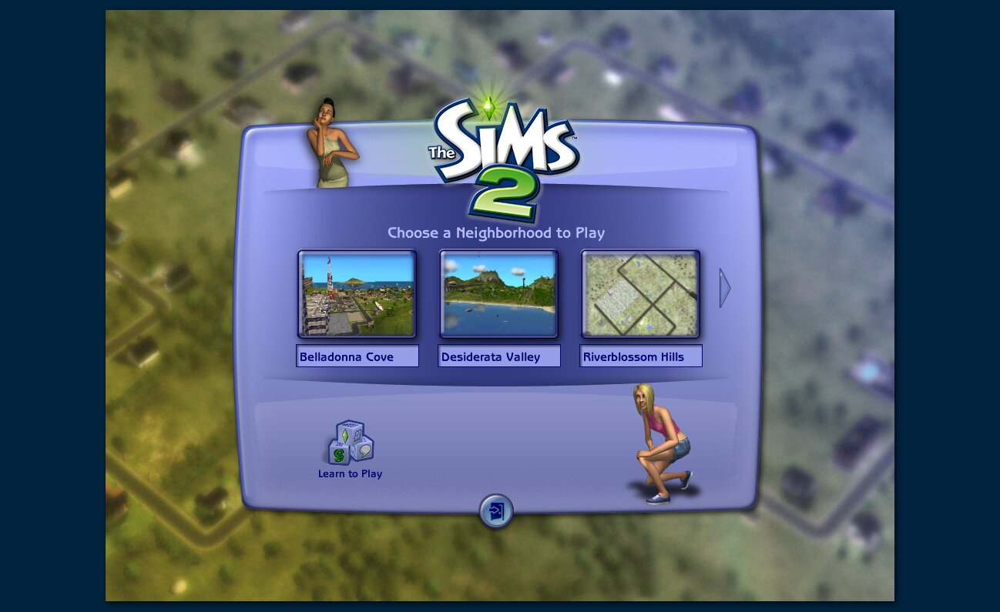
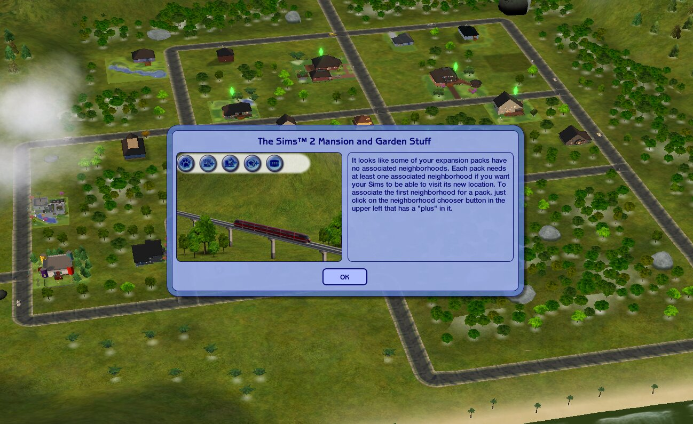

# The Sims 2 Legacy Collection: native port with the Fallout NV / Dungeon Siege II recompiler

This repository forks [fallout-nv-macos](https://github.com/Joshspeakman/fallout-nv-macos) at its `metal` branch
(`8bf8599`, the branch where FNV runs on the Mac: MojoShader → Metal, arm64 memory ordering, the Mac app and
`install.sh`). It points the static recompiler (x86 → C → clang) at the player's own **Steam** copy of
**The Sims 2 Legacy Collection** (app 3314070). As with the other ports, nothing from the game is committed. All
generated code goes under `recomp/work/`, which git ignores, and the game folder is only read.

The whole collection (base game, 8 expansions, 6 stuff packs) runs from a single executable, `EP9/TSBin/Sims2EP9.exe`.
The other folders (`Base`, `EP1`…`EP9`, `SP1`…`SP7`) hold only data.

| File | sha256 |
|---|---|
| `EP9/TSBin/Sims2EP9.exe` as Steam ships it (2026-10-07) | `24041f834e979cc088714713c3207540ff9093f51ff126450a4f7989432156b6` |
| the same, unwrapped by `tools/steamstub.py` | `7aaf7336249c05c31270416e5abeb5b438f0dc9e6af9d59ff34c6342a5abd9cc` |
| `EP9/TSBin/ijl15.dll` (Intel JPEG Library) | `41d37bfb0a39017497e0aa373dc01f71ac9c5046c75f7cd269bee52112a5f3a1` |

EA is still patching this collection, so `build_sims2.sh` refuses any other `Sims2EP9.exe`. `SIMS2_ANY_BUILD=1`
tries anyway. Once there are hooks at fixed addresses, a new build means a new analysis.

## Status (2026-10-07, done on Linux x86-64)

| Step | State |
|---|---|
| Steam DRM (`tools/steamstub.py`) | **new**. `Sims2EP9.exe` is wrapped in SteamStub 3.1 (x86). Its `.text` is AES-256-CBC encrypted (entropy 8.0) and the entry point sits in `.bind`. The tool decrypts `.text` in place and restores the original entry point (`0xa08248a3`, MSVC's `__security_init_cookie` + `__tmainCRTStartup`). Every section keeps its RVA and file offset. AES uses the `cryptography` module if present, otherwise the system `openssl`, so the Mac needs nothing extra. Check: all **145,357** base relocations inside `.text` hold an address inside the image after decryption (on the encrypted file, 144,746 of them don't) |
| Analysis (`tools/analyze.py`) | **109,632 functions, 97.3% of `.text`** (5.8 M instructions). 1,473 jump tables resolved, 190 unresolved (62 bounded heuristically while lifting). 4.5 min, about 26 GB of RAM at its peak |
| Lifting (`tools/lift.py --game sims2`) | all 109,632 functions lifted, **0 internal errors**, 4.9 min. Unsupported: only code that never runs (see below) |
| `ijl15.dll` | 1,736 functions, 0 internal errors. Every import is already implemented. Base 0x60000000 is free, so it's lifted as is |
| Compiling the generated C | **all 281 files compile** (exe + `ijl15.dll`, 111,368 functions), 0 errors, 589 MB of C, 2 min on 16 jobs (26 CPU-minutes). `build_sims2.sh` end to end, from the Steam folder: 7.5 min on 24 cores |
| SIMD lifter on Sims 2's instruction forms (`tests/fuzz_sse.py`) | exe: 289 forms / 680 instances × 60 runs, **0 mismatches** with Unicorn. `ijl15.dll`: 97 forms / 282 instances × 60 runs, 0 mismatches. **Bug found and fixed**: MMX `packsswb`/`packssdw`/`packuswb` used the XMM layout, so the source operand's half was dropped (FNV never used the MMX forms). **Added**: `pshufw` (66 sites in `ijl15.dll`) and `cvtpi2ps` (13 in the exe) |
| Integer/x87 lifter (`tests/fuzz_insn.py`) | 6,128 forms / 18,114 instances × 20 runs. Outside SIMD rows (this fuzzer does not seed XMM/MMX state; `fuzz_sse.py` covers those), only the expected differences remain: x87 transcendentals (`fyl2x`, `f2xm1`, `fprem`/`fprem1`: last-bit differences from the double model; one `fprem1` site lands one modulus apart in 2 of 20 runs, a quotient rounded at the half-way point) and `cpuid` (the fixed fake CPU) |
| Linking / running (Linux, SDL/OpenGL host) | **runs into a neighbourhood**: Steam check (offline shim), intro movies (EA MAD, decoded by the game), loading screen, the neighbourhood chooser with its 3D Sims, Desiderata Valley in 3D (clicked through with the host's scripted input). See "Running" below |

Build the C (Mac or Linux):

The analysis peaks at about 26 GB of memory (`analyze.py` caches a decoded instruction per address). That is tight on
a 32 GB Mac. If it swaps, run the analysis on a bigger machine, or bound that cache.

```sh
recomp/build_sims2.sh "/path/to/steamapps/common/The Sims 2 Legacy Collection"     # -> recomp/work/sims2/
```

### Unsupported instructions, and why they don't matter

The executable was rebuilt in 2025 with a current MSVC and keeps several CPU-specific paths, each chosen by `cpuid`:

- **3DNow!** (`pfmul`, `pfadd`, `femms`, … about 2,700 sites): the AMD paths of the statically linked D3DX.
- **AVX / AVX2 / AVX-512, SSE4.1, SSSE3** (`vmovdqu`, `vpshufb`, `pmulld`, `pcmpistri`, `palignr`, …): the CRT's
  `memcpy`/`strlen`/`memset` dispatch on `__isa_available`, plus a few math routines.
- `in`/`out`/`hlt`/segment registers/`enter` nesting (about 330): data decoded as code.

`rt_cpuid` with `rt_cpuid_sse2 = 1` reports a family 6 Intel CPU with SSE2 and nothing newer. Its highest basic leaf
is 1, so leaf 7 (AVX2) is never queried, and an extended-leaf query returns a value below 0x80000001, so there's no
3DNow!. Every one of these paths is therefore dead code. The lifter emits a trap there, so if one ever does run, it
names itself.

## What the executable needs (survey)

- **Steam.** If `SteamInternal_SteamAPI_Init` fails, the game shows "Steam Initialization Failed. The game failed to
  successfully launch from steam." and exits (`0xa0c2ba85`). On success it immediately calls
  `SteamInternal_ContextInit` and then `ISteamUser::GetSteamID` through a vtable (`0xa0c2b91d`). So `steam_api.dll`
  (8 imports) needs an *offline* shim that returns success and hands out small fake interface objects (ISteamUser,
  and whatever else `SteamInternal_FindOrCreateUserInterface` is asked for), built the way `d3d9.c` builds guest
  vtables. FNV's `galaxywrp` stubs (`SteamAPI_Init` → 0) are not enough here.
- **Shaders.** There's no `d3dx9_*.dll` import: D3DX, including its effect framework and the HLSL/asm shader
  compiler, is linked statically and gets lifted with the game. The game compiles its own shader text at run time
  and calls `CreateVertexShader`/`CreatePixelShader` with the bytecode, which is exactly the metal branch's
  MojoShader → MSL path. `vs_1_1`…`vs_3_0` and `ps_1_1`…`ps_3_0` all appear. Expect compile-time cost at start-up
  (lifted compiler), and cache by bytecode hash as FNV does.
- **Movies** are EA MAD (`MADk`, 412 `.movie` files), decoded inside the executable. No Bink, no external codec.
  `vp6vfw.dll` + `MSVFW32`/`AVIFIL32` are only the in-game **video capture** (`ICSeqCompressFrame`,
  `AVIStreamWrite`), so they can be stubs that report "no compressor".
- **Data folders.** Steam's `3314070_install.vdf` writes, for every pack,
  `HKCU\Software\Electronic Arts\The Sims 2 Ultimate Collection 25\Sims2<EP|SP>n.exe` with `path` =
  `<install>\<folder>` and `Installed` = 1 (`Sims2EP9.exe` → `Base`), plus the `EPsInstalled` list and `DisplayName`
  per language under the parent key. The executable reads the same key (`Software\Electronic Arts\The Sims 2
  Ultimate Collection 25\`, `ep%ddir`, `TSData`). The runtime's registry should be filled in from that `.vdf` at
  start-up rather than hand-written.
- **User folder**: `Documents\EA Games\The Sims 2 Legacy` (neighborhoods, downloads, `Config`, `Logs`, thumbnails).
- **Telemetry**: WININET posts a `boot_start` event (`"storefront" : "steam"`); `crashpad_handler.exe` is the crash
  reporter. Both get stubbed (no network, no child process).
- **Large-address aware** (characteristics `0x122`) with the image at 0xA0000000. Guest memory is one 4 GB region,
  so the address itself is fine, but anything in the runtime that assumes guest pointers < 0x80000000 (signed
  comparisons, the heap's top-down placement) needs checking.

## Running (Linux, 2026-10-07)




```sh
recomp/build_sims2.sh "<…>/The Sims 2 Legacy Collection"          # recompile (incremental) and link
SECS=150 recomp/tools/sims2_iterate.sh run                            # a windowed test session; log in recomp/work/run-*.log
DS_SHOT_RAW=1 DS_SCRIPT="@140:shot:/path/menu.png" SECS=150 recomp/tools/sims2_iterate.sh run   # screenshots
```

What it took, beyond the imports (all 438 are implemented):

- **Profile** (`SIMS2_EDITION`, `runtime/edition.h`): the exe at `EP9\TSBin` below the collection folder, the
  working folder there, registry from Steam's `3314070_install.vdf` (`w32_sims2_registry`), SSE2 CPU,
  shader-model-3 caps (`MODERN_EDITION`, shared with Fallout NV).
- **Offline Steam** (`sims2_imports.c`): `SteamAPI_Init` succeeds; ISteamApps008 `GetCurrentGameLanguage` and
  ISteamUser023 `GetSteamID` are the only methods the game calls.
- **Crash reporter** (crashpad, linked in): its setup `0xa0c2b206` is overridden to return (`SIMS2_OVERRIDES` in
  `lift.py`, `hooks.c`).
- **Lifter**: 16-bit `push`/`pop`/`pushf` (a Cyrix CPU check), reading segment registers (the CRT's fatal-error
  path), MMX `pack*` fixed, `pshufw`/`cvtpi2ps`.
- **PEB.ProcessParameters**: the newer CRT reads it in every thread.
- **Direct3D 9**: `Get/SetSoftwareVertexProcessing` keep the mode (the game keeps one caps copy per mode); a reused
  device takes the new behaviour flags; a windowed 0x0 back buffer is the window's client size; **a vertex shader
  without a pixel shader runs Direct3D's fixed-function texture stages** (`FF_PS`, `FF_MSL_PS` in
  `d3d9_shader.c`), which is how the game draws its UI, movies and much more.
- **Windows**: the game's `multimon.h` needs every monitor function by `GetProcAddress` (else an uninitialised rect
  places the window off-screen); `SystemParametersInfoA` answers unknown queries with 0.
- **Cursor**: kept in the game window's client coordinates; `GetCursorPos`/`SetCursorPos` now convert to and from
  screen coordinates (the game centres its window, so it saw the cursor outside it).
- **Two-level switches** (`movzx idx, byte [x + table]`): the bound must be a `cmp` on the byte table's own index
  register; another `cmp` in between gave 2 of 8 cases (crash entering a lot).
- **Jump tables**: the lifter bounded a switch by decoding backwards from the jump, which can start inside an
  instruction and miss the `cmp`; it now walks the function's own decoded instructions first (`known_prev`).
  Heuristically bounded tables: 62 → 28. One of them crashed the neighbourhood load.
- **D3DX**: its shader assembler uses `Direct3DShaderValidatorCreate9` even when it isn't found; it is now there and
  accepts everything. `CreateDIBSection`/`GetObjectA`/`GetDIBits` on DIB sections are implemented.
- **Files**: the game opens every package for writing. Such files are now read where they are and copied into the
  data folder's overlay only on the first write (`File.cow`, `files.c`); before, 8.5 GB of packages were copied.

## Next

1. **Interaction**: the neighbourhood is interactive (dialogs, the lots and families panels, lot cards). Drive a
   session with `DS_SCRIPT` (`@145:tap:648,380;@160:tap:607,630` opens Desiderata Valley) and, live, with
   `DS_CMDFILE=<file>` (append `tap:x,y` / `shot:<png>` lines). `tap` puts the cursor straight on the spot and
   hovers 15 frames before clicking (`click` passes through the screen corner, which scrolls the game's camera).
   Not yet: entering a lot (live mode), Create-a-Sim, build/buy. Open problems seen in the neighbourhood:
   - the camera drifts slowly and steadily on its own, from before any input, at the same speed at 60 and 210 fps
     (`DSR_FPSCAP=60`), and not from the cursor (`W32_INPUTLOG=1` shows it inside the window and no key down).
     It makes houses hard to click; the lots panel works instead;
   - the ocean draws dark green or black (water shader / reflection target), some rocks draw black;
   - household thumbnails in the families panel are red T-posed figures (the offscreen Sim thumbnail render:
     no skinning or textures); lot thumbnails are fine;
   - loading is slow (main menu after about 140 s, a neighbourhood about 3 minutes later). Neither the game
     thread nor the render thread is busy (about 55% and 45%), so the loading is paced by frames or sleeps:
     profile with `W32_PROFILE`.
2. **The Mac**: see "The Mac (2026-10-09)" below.
3. **C++ catch continuations** (done on the Mac, 2026-10-09: `lift.py` `cxx_continuations` makes the address each catch
   funclet returns a landing-pad target, for both `push stub` and `__EH_prolog` prologues; `rt_call` takes the pad
   whose registration node is in ebx). Before: a `throw` that the game catches can't resume yet (`lift.py` registers `__except`
   blocks only). None was needed to reach the menu. A known case: with a data folder left by earlier broken runs
   (kept as `~/.local/share/sims2-linux-badstate`), a curve property reaches its parser empty, and
   `std::length_error` ("vector too long") ends the game about a minute in. It would on Windows too, so the bad
   state, not the catch, is the bug: find what wrote it.
4. **Audio**: test sessions mute it (`W32_AUDIO_MUTE`); not checked yet.
5. **Build**: every C file was being recompiled after each relink, because `build_linux.sh` rewrote
   `compiler-flags.txt` (making it newer than the objects); it now replaces the file only when it changes. Check
   that the next lifter change recompiles only the affected files.

## The Mac (2026-10-09)

Built and run on an M1 Pro (32 GB; the analysis was copied from the Linux build, see below). Test mode at 1280x720,
intro movies skipped: the neighbourhood chooser in about 25 s, Desiderata Valley within 45 s of choosing it, the
Contrary family's lot in about 20 s; a neighbourhood about 100 fps uncapped (2,000 draws a frame), live play 65-110
fps uncapped, 85-90 at twice the resolution (DSR_RENDER_SCALE=2). 15 minutes of speed-3 play: no faults, 11 C++
exceptions caught, memory 1.1-1.3 GB with no growth. What it took:

- **Shader constants**: the renderer dropped a program's constants above 8 KB (`renderer.m` `vcb`). MojoShader lays
  out each relative-addressed array from its base to c255, so the Sims' skinning shaders (arrays at c18, c26, c56,
  c57, c58) need about 17 KB: without them the Sims drew as huge spikes. Now 64 KB (vertex) and 16 KB (pixel).
- **ps_1_1..1_3 on Metal**: texture registers start out holding their coordinates; GLSL reads built-ins, Metal needs
  inputs. `mojoshader.c` `ps1x_texcoord_input` registers each t register used as a TEXCOORD attribute (the floors'
  shaders failed with "use of undeclared identifier 'input'" and the floors were missing).
- **Vertex slots**: the Sims' declarations carry positions 4-7, normal 4 and blend indices 4 (morph targets): slots
  16-22 positions 1-7, 23-29 normals 1-7, 30 and 31 blend indices and weights 1-7 (`d3d9.c` `sem_slot`,
  `d3d9_shader.c` `slot_of`, the renderer's `slot_reg`).
- **GetContainer**: a surface asked for `IDirect3DBaseTexture9` returned the device, and the game's `GetType` call on
  it reached `SetCursorProperties` with a junk pointer (a crash entering a lot). It now answers by IID.
- **Monitor shape**: `GetDeviceCaps(HORZSIZE)` follows the screen's shape; every monitor read as 4:3 before.
- **Settings**: the game keeps them in `Config/userProps.xml` (`optionShadows` 1-3 and the other Options screen
  levels, `edgeScrolling`, `horzedgescrollrate`, `CameraDriftCamEnabled`, `activeDeviceDisplayMode`). The host writes
  the launch window's choices and screen there before the game starts, or into `userStartup.cheat` (as the
  properties `Graphics Rules.sgr` sets for each level) on a first run, before the file exists.
- **Camera drift** (item 1): `CameraDriftCamEnabled`, the game's idle drifting camera. The launch window turns it off
  by default; with it off the neighbourhood camera holds still.
- **Interface size**: the game runs at the resolution divided by the size and the renderer draws at the full
  resolution (`DSR_RENDER_SCALE`), as in the Fallout NV port.
- **Zoom**: the wheel and the X/Z keys zoom the game's camera; a trackpad pinch sends wheel steps.
- **Performance** (2026-10-09; the neighbourhood was 42 fps, live play 40-50, start-up to the chooser 140 s):
  - `rt_call`, under every virtual call, walked all the thread's SEH landing pads (now only when the target is a
    registered handler: a set filled by `rt_seh_push`) and binary-searched 110,000 functions (now a hash).
  - Vertex and index buffers: a partial update of a buffer the GPU was reading made a new `MTLBuffer` and copied the
    whole old one. The game's lock flags now reach the renderer (NOOVERWRITE: in place; DISCARD: no copy), and
    replaced buffers are pooled until the GPU is done.
  - `VirtualAlloc` found free space by probing every 64 KB against every region (now one pass over the gaps).
  - The runtime is built at -O2 (was -O1); the intro movies can be skipped (`SIMS2_SKIP_INTRO`, the launch window).
  - RefPack compression, which the game does while it plays (saving Sims' data): natively (`refpack.c`, checked
    against 15,685 of the game's own compressed resources and by round trips); as recompiled code it took up to 3 s.
  - Every guest memory access is ordered (RT_TSO: acquire loads, which clang already makes `ldapr` on Apple
    Silicon, and release stores); about twice the cost of plain accesses in a memory-bound loop, not changed.
- **C++ catch blocks** (the game froze about 2.5 minutes into speed-3 play): see item 3 of the list above, now done.
- **Fixed-function**: lighting is done per vertex on the CPU (`ff_lit`; the house pictures the game redraws after a
  build edit had white roofs), stage 1 camera-space texgen and a third texture stage (projected shadows and lights).
- **ProcessVertices** runs the vertex shader on the CPU (`d3d9_vsinterp.c`): the families' thumbnails were red
  unposed figures.

Build on the Mac without the 26 GB analysis: copy `recomp/work/sims2/analysis.json` from a machine that made it and
`touch` it (`build_sims2.sh` keeps an analysis newer than `analyze.py`).

Checked on the Mac (test mode): Create-a-Sim (a new family made and moved into the bin), build and buy (an object
bought, undone, sold; a wall and a floor), the game's own Graphics options (applied), saving (a purchase still there
after saving and coming back), the families' thumbnails, audio (recorded with `W32_AUDIO_DUMP` while muted: music in
the menus and neighbourhood, sounds and music in a lot). The 2026-10-09 audit follow-up also checked an installed
build for 26 minutes, a saved household reloaded on an isolated copy, the normal launcher, and the repaired
Create-a-Sim mirror with a Sim present. A subsequent native fullscreen check covered all four neighbourhood
scrolling edges, loading, a household view and quitting (see the geometry fix below). Multi-hour sessions remain untested.

### Neighbourhood pond (reference checked, 2026-10-09)

The dark Central Park pond is Apartment Life's decorative neighbourhood pond. Its silhouette, islands, lily pads,
painted ripples and dark green surface match the original-object picture published by the creator of
[AL Neighborhood Deco Pond, Recolored](https://db.modthesims.info/d/442741/al-neighborhood-deco-pond-recolored.html).
The live-lot view also clearly shows those painted ripples. The earlier claim that these pixels were a lake bed
missing a water pass was not supported; a reflection render target is not required to draw this decoration.
This reference comparison does not establish correctness of every ocean, pool or mirror effect.

Earlier shader experiments painted lot markers with the cube-sampling shader (vs 0376492c / ps 0d292ba2),
not this pond. Do not change those markers' shader to repair the pond. For other effects, use
`D3D9_DRAWTRACE_ON=<file>`, `D3D9_SKIP_SHADER=<hash,...>`, `D3D9_PAINT_MSL=<text>` and `D3D9_MSL_DUMP=<dir>`.

### Stalls when new content appears (open, 2026-10-09)

Frames 0.5-1.2 s late in live play when Sims or objects first appear, and an 11 s stall while a neighbourhood first
loads (DS_STALL_MS=<ms> profiles them). The presenting thread's stacks all run through EA's texture image manager
(f_a016b2a0 / f_a016b0d0, which reference GZGraphic4ImageManager's source path) into a statically linked image library
at low addresses (f_a001d57c < f_a0036c3b < f_a003480a, rows of 16-byte colours; f_a00416a2 / f_a0084dcb /
f_a0084173 on 4x4 blocks of colours: format conversion and block compression), written with x87 floating point,
which the recompiled code runs much slower than the CPU would. Refusing DXT formats (an experiment) didn't change
them. The audit fixes now memoize successful BC1 blocks at `f_a0084dcb`, retaining the original compressor on
misses. The key includes every input byte, flags and x87 control word; collisions compare the full input.
The known edition's constants are unchanged. Entries have checksums and an edition/version-specific disk format.
This avoids repeating expensive work, including across launches; unique blocks and other image conversions still
run in lifted code. It does not eliminate all first-appearance/loading stalls. `SIMS2_TEXTURE_CACHE_VERIFY=1`
executes the original compressor on hits and reports byte mismatches at exit; use it when changing this hook.

### Mac audit fixes (2026-10-09)

- Fullscreen edge scrolling: `ShowWindow(SW_MAXIMIZE)` now sizes the guest window to the emulated desktop,
  saves its normal bounds for restore, and exposes the real maximized state through `IsZoomed` and
  `GetWindowPlacement`. `WM_SIZE` reports client dimensions; a thin border no longer implies a caption.
  Previously a 1728x1116 mode left a borderless window at (-3,0), sized 1734x1119. The cursor could travel beyond
  the right desktop edge without triggering scrolling, and loading/menu frames retained a coloured strip.
  With the corrected 1728x1116 rectangle at (0,0), an Around the Notch fullscreen check scrolls all four edges.
  Synthetic maximize/restore and client-coordinate regressions run on both macOS and Linux.
- A programmable vertex shader followed by fixed-function texture stages now honors `D3DTTFF_PROJECTED`.
  Both GLSL and Metal divide the interpolated coordinates by their fourth component in the fragment shader.
  The COUNT flags belong to fixed-function vertex processing and remain disabled on this path; see
  [D3DTEXTURETRANSFORMFLAGS](https://learn.microsoft.com/en-us/windows/win32/direct3d9/d3dtexturetransformflags).
  The GPU regression compiles the real fallback shader and checks projected/unprojected pixels for all four stages,
  using constants packed by the runtime. The CAS mirror uses this path with a screen-sized reflection target;
  an in-game check now shows both the room and the Sim reflected instead of a black surface.
- Cursor images are copied at `SetCursorProperties`; source surfaces may be released or changed safely.
- `SuspendThread` parks the calling guest thread with a counted condition-variable wait, also supports a
  not-yet-started thread, and reports unsupported instead of pretending to suspend another active thread.
  `ResumeThread` uses the same lock. Shutdown no longer floods the log with false-success warnings.
- Samplers honor anisotropy (when requested), W addressing, maximum mip level, sRGB reads, and Metal's three
  native border colours. LOD bias uses Metal's descriptor on macOS 26+ with a sufficiently new SDK. Every
  descriptor state participates in the sampler cache key; texture views are released with their surfaces.
  Arbitrary coloured D3D border values and LOD bias on older macOS still need shader emulation. MSAA remains
  unavailable until multisample surfaces and resolves are implemented; the debug switch no longer falsely
  advertises it. Do not force it on in the game's configuration.
- Identical Metal source/entry pairs reuse compiled functions. Previous-session sources are warmed at renderer
  startup. Compatible colour pipelines use a persistent Metal archive keyed by GPU, OS and compile policy;
  depth-only pipelines stay in memory because some drivers cannot serialize them. The tested macOS 27.2 beta
  also rejected some colour pipelines during archive serialization. On a write failure, a per-device/OS marker
  disables further archive writes across launches; the last good archive remains readable and shader-source
  warmup continues. Removing the cache retries writes. Corrupt/unwritable caches fall back to ordinary compilation.
  A valid NSError pointer is always supplied on archive writes.
- The frame limiter waits on a Mach deadline instead of spinning through the last 2 ms. It retains the game's
  existing cadence; this is not a new display-synchronization implementation or a promise to remove loading hitches.
- `DebugSetMute` is a supported zero-argument release-runtime no-op. Other missing exports log the first call and
  powers of two. The active app log rotates at 5 MB, checked twice per second, retaining `.previous` alongside
  the existing launch-time `.old.log`.
- Runtime compilation has bounded parallel jobs (`SIMS2_BUILD_JOBS`), checks every child result, and stages objects
  and the linked library before replacing a successful build. A compile failure preserves the previous build.
- `recomp/tests/check_macos.sh` runs native CPU, failure-injection, host compilation and synthetic Metal pixel tests.
  `.github/workflows/macos.yml` runs it on macOS. A CI VM without a GPU reports an explicit Metal execution skip;
  the local Mac check requires the GPU tests to pass. No game assets are needed for these tests.

Local caches live in `~/Library/Caches/io.github.sims-2-macos/{Metal,Textures}` and may be removed with the game
closed. `DSR_SHADER_CACHE=0` disables persistent shader caching; `SIMS2_TEXTURE_CACHE=0` disables block caching.
Development overrides: `DSR_CACHE_DIR`, `DSR_TEXTURE_CACHE_DIR`, `DSR_PSOLOG`, `SIMS2_TEXTURE_CACHE_LOG` and
`SIMS2_TEXTURE_CACHE_VERIFY` (verification costs the original compression time).

### Checked and not bugs (2026-10-09)

- Sim portraits: the 128x128 readbacks are the two halves of each portrait (the game renders them as tiles); the
  portraits in the interface are centred.
- Roofs are hidden in live mode on the ground floor with walls up, as in the game.

### Launch, coast and Sim geometry follow-up (2026-10-09)

- The Play window stays visible with a starting indicator until the game window is presented. Fullscreen and
  mouse capture wait for AppKit activation, including the already-active case, and the game joins the active Space.
- Belladonna Cove's ocean uses the fixed-function three-stage renderer. It now preserves the fourth projected
  texture coordinate and implements `D3DTSS_RESULTARG` / `D3DTA_TEMP`. Previously COUNT4 projection divided by z
  and the reflection blend read diffuse instead of TEMP, producing a bright cloudy pattern. Synthetic GPU tests
  cover COUNT2/3/4 across all three stages and TEMP/CURRENT blending.
- Metal relative shader constants now use one bounded register bank, preserve signed offsets and local `DEF`
  values, and return zero outside the D3D register range. Sim meshes use unused bone indices of 255, multiplied
  by three; unchecked reads previously fetched unrelated uniforms, leaving missing body/hair triangles and
  incomplete portraits. Synthetic bytecode reproduces the old bad read and checks the correction with and
  without CTAB. The affected Cleveland scene and Justin's walking frames render complete geometry after the fix.
- Marissa's newly generated selected portrait has hair and a complete torso. Previously generated bald images
  can persist as JPEG resources inside the character package; deleting `FamilyThumbnails` alone does not refresh
  those individual headshots. Normal household saves regenerate them. Do not delete character packages.
- Original Steam references from the reference host are tracked in [issue #1](https://github.com/Joshspeakman/sims-2-macos/issues/1):
  the Windows game under Proton/DXVK on RTX 3080 Ti, compared with the native M1 Pro build. Day/night coast,
  apartment lighting and projected lot shadows were inspected. Cameras, aspect ratios and save times differ;
  this is a visual comparison, not a pixel-identical conformance claim. Private saves, game shaders and capture
  bundles remain outside the repository.

## Tests

```sh
recomp/.venv/bin/python recomp/tests/fuzz_sse.py recomp/work/sims2/Sims2EP9.exe recomp/work/sims2/analysis.json build
recomp/.venv/bin/python recomp/tests/fuzz_sse.py recomp/work/sims2/Sims2EP9.exe recomp/work/sims2/analysis.json run 60
FUZZ_EXE=recomp/work/sims2/Sims2EP9.exe FUZZ_ANALYSIS=recomp/work/sims2/analysis.json recomp/.venv/bin/python recomp/tests/fuzz_insn.py build
FUZZ_EXE=... FUZZ_ANALYSIS=... recomp/.venv/bin/python recomp/tests/fuzz_insn.py run 20
python3 recomp/tools/import_gap.py recomp/work/sims2/Sims2EP9.exe
```

`fuzz_insn.py` now skips instances whose absolute memory operand falls in the guest NULL page. Those are data decoded
as code, such as `add byte ptr [0xa001], cl`: they segfaulted the native test library, and they would fault on
Windows too.


### Oversized Metal upload follow-up (2026-10-10)

A single upload larger than the Metal ring previously returned an out-of-bounds range. The renderer now waits
for prior GPU work and grows the ring for that upload or the full draw reservation, with 64-bit range checks.
The normal 256 MB capacity is unchanged. `recomp/tests/renderer_ring_test.sh` runs without game assets and disables
the persistent shader cache for isolation. The old implementation fails before writing; the corrected oversized
allocation, complete draw reservation, real Metal buffer copy and wrap pass ASAN/UBSAN. This is a stability fix,
without an average-FPS improvement claim.
